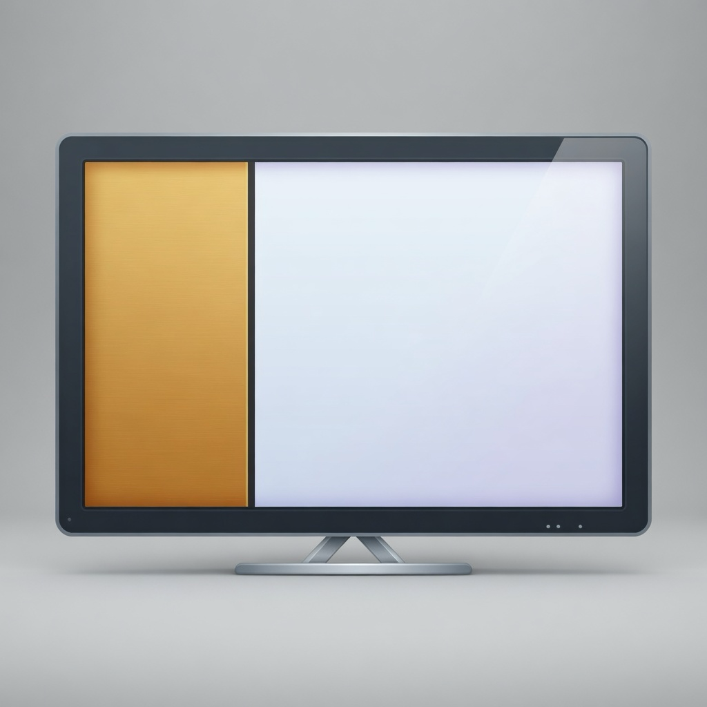

# diyplay

<p align="center"></p>

A tiny macOS menu-bar app that does the one BetterDisplay job that actually matters for many setups:

1. **Identify** the connected display (name, vendor/product, current pixels)
2. **Set physical resolution** when EDID is lying (PBP, TVs, cropped panes)
3. **Offer HiDPI sizes** derived from that physical size

Not affiliated with [BetterDisplay](https://github.com/waydabber/BetterDisplay). Not a clone: no virtual screens, XDR, DDC, PIP, or connection-mode matrix.

Apple Silicon is the intended target. Tested on an M4 Mac mini + INNOCN 32C1U in PBP.

---

菜单栏小工具。核心不是某一台 32C1U，而是：**认屏 → 必要时改物理像素 → 再选「看起来多大」**。

## Menu

```
32C1U  ·  正常
识别  2824×2160    物理  2824×2160
────────────────
物理分辨率
  用识别到的 2824×2160
  Phone 右窗    2824×2160     (32C1U preset)
  对半 1:1      1920×2160     (32C1U preset)
  整屏 4K       3840×2160     (32C1U preset)
  自定义…
────────────────
  更锐 / 日常 / …
────────────────
  重新应用    登录时启动    退出
```

Other monitors skip the 32C1U presets and get a generic HiDPI ladder from whatever physical size you set.

If you change the monitor OSD (for example PBP Phone → 1:1), change **physical resolution** in diyplay to match. Then sleep or unplug HDMI once if the HiDPI list does not update.

## Install

macOS 14+, Xcode / Swift 6 toolchain.

```bash
git clone https://github.com/fisherever/diyplay.git
cd diyplay
make install
```

That builds `~/Applications/Diyplay.app`, opens the menu-bar extra, and (once, with sudo) gives your user write access to `/Library/Displays/Contents/Resources/Overrides` so later native changes do not need sudo.

Check **登录时启动** in the menu if you want it back after login.

```bash
diyplay doctor          # after install, or: .build/release/diyplay doctor
diyplay displays
diyplay native 2824x2160
diyplay res 1920x1469
```

## Status (this machine)

On an M4 mini + INNOCN 32C1U PBP Phone pane, with BetterDisplay uninstalled:

- Switching HiDPI sizes: OK
- Sleep / wake: OK
- Unplug / replug: OK
- Reboot: OK — WindowServer restores 2824×2160 physical + 1920×1469 HiDPI from the override alone
- Forcing HDMI connection mode (the BetterDisplay Pro `connectionMode` lever): **not implemented**. If the OS falls back to 1080p TV timing, diyplay cannot currently push 2824×2160@60 by itself.

## Warning

Writing `DisplayPixelDimensions` is a real display override. A wrong native size (2560 vs 2824, 2824×1080 vs 2824×2160) looks like a tiny sharp corner or a blurry stretch. Set physical size to the **visible pane**, not the panel’s marketing 4K.

`make install` changes ownership of the system Overrides directory so the app can write. That is a personal-machine tradeoff, not something to run on a managed fleet.

## License

MIT. See [LICENSE](LICENSE).
